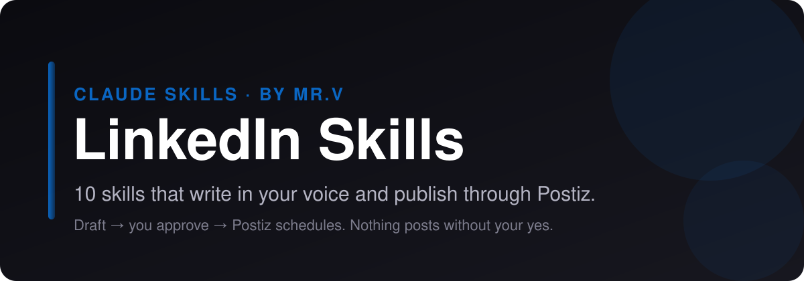

<p align="center">
  
</p>

# LinkedIn Skills for Claude Code, Claude.ai and Codex

<p align="center">
  
  
  
  
  
</p>

**Claude skills for LinkedIn.** 10 skills that plan, write, scrub and publish your LinkedIn content. They draft in your voice, strip the AI tells, and hand finished posts to [Postiz](https://postiz.com) for scheduling, only after you approve. No coding required.

> **On another platform too?** Matching bundles: [X (Twitter)](https://github.com/mrvsubstack/x-skills) · [Instagram](https://github.com/mrvsubstack/instagram-skills) · [Threads](https://github.com/mrvsubstack/threads-skills) · [YouTube](https://github.com/mrvsubstack/youtube-skills) · [Facebook](https://github.com/mrvsubstack/facebook-skills) · [TikTok](https://github.com/mrvsubstack/tiktok-skills) · [Pinterest](https://github.com/mrvsubstack/pinterest-skills) · [Reddit](https://github.com/mrvsubstack/reddit-skills). Same voice rules, same approve-before-publish flow.

> **Want the full library?** These are a free sample of the Mr V Skills library: 240+ skills for writing, newsletters, offers, ads, SEO and research. [Get it on Substack →](https://promptwithjason.substack.com)

## Install

### Claude.ai (web) or Claude Desktop

1. Click **Customize** in the sidebar and open **Plugins**
2. **Add** → **Add marketplace** → **Add from a repository**
3. Paste `mrvsubstack/linkedin-skills` and sync
4. Open **Discover**, find **linkedin-skills**, click **+** to install
5. Start a new chat and ask for a LinkedIn post

> Plugins need a paid Claude plan with code execution turned on.

### Claude Code

```
/plugin marketplace add mrvsubstack/linkedin-skills
/plugin install linkedin-skills@linkedin-skills
```

Or clone it and open the folder. The `.claude/skills/` folder points at every skill, so they load with no install:

```bash
git clone https://github.com/mrvsubstack/linkedin-skills.git
cd linkedin-skills
```

### Any agent (Codex, Cursor and others)

```bash
npx skills add mrvsubstack/linkedin-skills
```

Or point your agent at `skills/*/SKILL.md`. Each one is plain markdown.

> **Found this useful? [Star the repo](https://github.com/mrvsubstack/linkedin-skills).** It's how the next person finds it.

## What you can do

Ask in plain English. The right skill picks itself.

**Write a post:**
> "Write me a LinkedIn post about why I stopped using a content calendar. I want comments."

**Steal a structure:**
> "What hook formula does this post use? [paste the post]"

**Plan the week:**
> "Make a 7-day LinkedIn plan. I'm a solo consultant selling to agency owners."

**Fix your profile:**
> "Rewrite my LinkedIn headline and About section for inbound leads."

**Strip the AI tells:**
> "Humanize this draft before I post it: [paste]"

**Ship it:**
> "Schedule that post to LinkedIn through Postiz for Tuesday 8am my time."

Every skill shows you a draft first. Nothing goes out until you say yes.

## The 10 skills

| Skill | What it does |
|---|---|
| **Linkedin Post Writer** (`linkedin-post-writer`) | Writes a LinkedIn post from a topic or rough notes, using a hook picked by the reaction you want (comments, reposts, likes or saves), a fold-proof opening and a clean pre-publish scrub, then hands it back as a copy-ready block. |
| **Linkedin Profile Optimizer** (`linkedin-profile-optimizer`) | Audits a LinkedIn profile section by section and rewrites the headline, About, Featured and Experience so the profile turns post readers into inbound leads, job offers or followers. |
| **Linkedin Content Planner** (`linkedin-content-planner`) | Builds a 7-day LinkedIn plan from your theme, audience and pillars: which day gets which pillar, hook family, format, goal reaction and close, plus a daily list of people to comment on and a weekly balance check. |
| **Linkedin Comment Drafter** (`linkedin-comment-drafter`) | Drafts 1–3 comments on someone else's LinkedIn post (or a short take for resharing it) that add something the author and readers didn't already have, so the author replies and their audience finds you. |
| **Linkedin Reply Handler** (`linkedin-reply-handler`) | Drafts replies to the comments on your own LinkedIn posts — one comment, or the whole thread in one batch — filtering out the ones not worth answering and writing replies that keep the conversation (and the post's reach) going. |
| **Linkedin Hook Extractor** (`linkedin-hook-extractor`) | Takes a LinkedIn post that did well and reverse-engineers it: which hook family it uses, what each section does, why it worked, what not to copy, and a blank template you can fill with your own topic. |
| **Linkedin Repurposer** (`linkedin-repurposer`) | Rebuilds something you already made — a tweet, thread, video script, blog post, newsletter or caption — into a native LinkedIn post with a new hook above the fold, LinkedIn length and spacing, real stakes and the link moved out of the body. |
| **Linkedin Humanizer** (`linkedin-humanizer`) | Strips the patterns that make a LinkedIn post or comment read machine-written — stacked AI vocabulary, reveal bridges, staccato fragments, triple lists, performed honesty — without flattening the writer's real voice. Three modes: Rewrite (default), Audit (pass/fail review before posting, no rewrite) and Profile (learn your voice from 3–6 past posts). |
| **Linkedin Engager Analytics** (`linkedin-engager-analytics`) | Sorts the people who liked or commented on your LinkedIn post into peers, people to learn from, likely buyers and everyone else, then hands back who to follow, whose posts to comment on, and who to message with a one-line opener. Works from the engager list you copy or export. |
| **Postiz Publisher** (`linkedin-postiz-publisher`) | Checks a finished post against LinkedIn's rules, shows you an approval card, and schedules it through Postiz after you say yes. Saves a copy-ready file when Postiz isn't set up. |

Some skills suggest companion skills from the other platform bundles or from the [full Mr V library](https://promptwithjason.substack.com) (for example `voice-profile-bank` or `final-edit-modes`). They're optional. Without them, each skill still does its whole job.

## Publish with Postiz

By default the skills hand you a copy-ready post. Connect [Postiz](https://postiz.com) and Claude can schedule it for you.

**Why Postiz:** it's open source, you can self-host it for free, and one account covers LinkedIn plus 25+ other channels. The hosted plan works too.

**Setup (5 minutes):**

1. Create a Postiz account (or self-host it) and connect LinkedIn under **Add Channel**.
2. Copy your API key from **Settings** → **Public API**.
3. Save it as an environment variable, not in the chat:
   ```bash
   export POSTIZ_API_KEY="your-key"
   # self-hosted only:
   export POSTIZ_API_URL="https://your-domain/api/public/v1"
   ```
4. Restart Claude and ask: **"List my Postiz channels."**

Full guide: [`skills/linkedin-postiz-publisher/references/postiz-setup.md`](skills/linkedin-postiz-publisher/references/postiz-setup.md).

**How a post ships:**

1. A writer skill drafts the post.
2. You edit until you like it.
3. `linkedin-postiz-publisher` checks it against LinkedIn's limits and shows an approval card: account, local time and UTC, media, exact text.
4. You say yes. It schedules through Postiz and gives you the post id.

No key? It saves the post to `post-ready-to-paste.txt` instead. Nothing breaks.

**Not published through Postiz:** Comments and replies (Postiz's public API publishes posts, not comments). Those skills hand you a copy-ready block.

## Voice rules every skill follows

1. A number or a statement in line 1. Never open on a question.
2. Odd precision beats round numbers: "$4,730" reads like a receipt, "$5k" like a guess.
3. One real detail per post. If you didn't give one, the skill asks. It never invents one.
4. No stock AI words (leverage, robust, elevate, navigate, foster, delve).
5. No reveal bridges ("Here's the thing", "Plot twist:") and no staccato stacks ("Simple. Fast. Done.").
6. Em dashes capped at about one per 100 words.

## Troubleshooting

| Problem | Fix |
|---|---|
| Skills don't activate | Start a new chat after installing. In Claude Desktop, check the plugin is listed under **Yours**, not only **Discover**. |
| "Postiz isn't connected" | `POSTIZ_API_KEY` isn't visible to Claude. Set it in your shell profile, open a new terminal, restart Claude. |
| 401 from Postiz | The key is wrong or was regenerated. Copy it again from Settings → Public API. |
| 429 from Postiz | You hit Postiz's hourly posting limit. Wait and try again. |
| LinkedIn channel not found | Connect it in the Postiz dashboard, or reconnect it if it shows as disabled. |
| Validation error on a post | A required platform setting is missing. The publisher reads the error and asks you for it. |

## Credits and license

Several skills here were rewritten in Mr.V's own words from methods in Serge Bulaev's MIT-licensed [linkedin-skills](https://github.com/sergebulaev/linkedin-skills). See [CREDITS.md](CREDITS.md).

MIT licensed. See [LICENSE](LICENSE). Not affiliated with LinkedIn or Postiz.

Made by **Mr.V** · [Substack](https://promptwithjason.substack.com)
